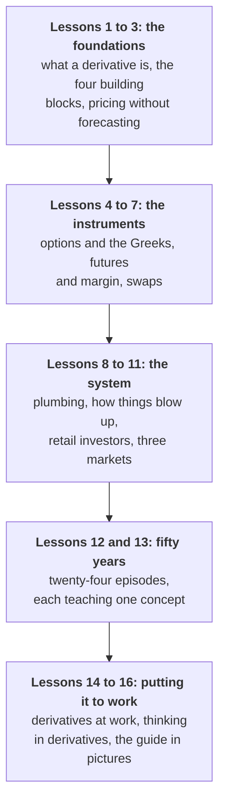

# Derivatives from First Principles

*What derivatives are, how they are priced without anyone forecasting anything, who uses them, how they go wrong, and how the US, the UK and India run their markets.*

---

## Why this guide exists

At the end of 2025 the world's banks had **$844.6 trillion** of over-the-counter derivative contracts outstanding, more than seven times the output of the entire world economy. The number is true, alarming and almost meaningless: after netting, about $3.4 trillion was genuinely at risk. Learning why is the first step to reading derivatives news sensibly.

Derivatives fix the price of your energy, set the rate on your mortgage, keep airlines flying when oil spikes and protect pensions against falling interest rates. They also sank Barings, nearly sank the world's largest insurer, and drained the cash of a generation of British pension funds in a single week in 2022. This guide builds the machinery one piece at a time, shows the arithmetic where the arithmetic is the point, and then tests every idea against an episode where it decided the outcome.

> **Three ideas unlock almost everything.**
>
> 1. **Derivatives move risk around; they do not create or destroy it.** Always ask who now holds the risk, and whether they can afford it.
> 2. **Leverage turns small price moves into large cash demands.** Losses are collected in cash, often every day, and many famous blow-ups were about running out of cash before being proved right.
> 3. **Options put a price on uncertainty.** A choice is worth more when the future is more uncertain, so an option's price is really a price for volatility.

### What you will be able to do at the end

- Take any product apart into the four building blocks, and see the bets hidden inside it.
- Explain why a forward or futures price is not a forecast, and price a simple option by building a copy of it.
- Read an option's price, its Greeks and its implied volatility, and say what a seller is really being paid for.
- Follow a futures margin account, a swap's collateral and a clearing house's default waterfall through a crisis.
- Recognise the six patterns behind fifty years of derivative disasters, and the four questions that would have prevented most of them.
- Describe how derivatives are traded and regulated in the United States, the United Kingdom and India.

### Who it is for

Anyone who reads the business pages and wants the derivatives parts to make sense, and anyone who works near this market, in a bank, an insurer, an energy company, a manufacturer or the technology teams that serve them. No prior finance is assumed, and the only arithmetic is arithmetic you can check on a calculator. Formulas, where they help, are folded away in optional boxes.

---

## How the guide is built

**One running example.** Lessons 3 to 5 follow a single option, a three-month call to buy a £100 share for £105, costing £3, through every way an option can be priced, hedged, win and lose.

**Three markets throughout.** The guide compares the United States, the United Kingdom and India side by side: the deepest futures and options markets, the world's swap shop, and the world's busiest retail options market.

**Every concept gets an episode.** Lessons 12 and 13 tell twenty-four stories, from the first listed options in 1973 to the Hormuz oil shock of 2026, each isolating one idea.

Each lesson ends with a few **Check yourself** questions; the answers stay hidden until you open them, and most involve a number you can work out first.

---

## The lessons

### 1. [What a Derivative Is](lesson-01-what-a-derivative-is.md)

A contract about something rather than the thing itself. Why every derivative is zero-sum between its two sides yet rarely a bet, the four jobs derivatives do, why the $845 trillion headline misleads, and a history older than coins.

### 2. [The Four Building Blocks](lesson-02-the-four-building-blocks.md)

Forwards, futures, options and swaps: the weakness each was invented to fix, how they relate, the family tree, and a retail savings plan taken apart to reveal the crash insurance inside.

### 3. [The Price Nobody Forecasts](lesson-03-the-price-nobody-forecasts.md)

No-arbitrage pricing from scratch: the cost of carry, why the basis closes at expiry, why currency forwards are set by interest rates, put-call parity in numbers, and a one-step tree that prices an option with arithmetic alone.

### 4. [Options: Paying for Uncertainty](lesson-04-options-paying-for-uncertainty.md)

The four basic positions, the running example, the six inputs, time value and its accelerating decay, volatility as a range, implied against realised volatility, the VIX, the skew and the volatility crush.

### 5. [The Greeks, Hedging and Strategies](lesson-05-the-greeks-hedging-and-strategies.md)

Delta, gamma, theta, vega and rho; a dealer's hedge followed day by day; why owning an option means owning volatility; the classic strategies; and a decade of selling insurance on real data.

### 6. [Futures: Living With Daily Settlement](lesson-06-futures-and-daily-settlement.md)

A margin account evening by evening, what leverage really means, reading the market's rate forecast from SONIA and SOFR futures, the Treasury basis trade, and basis risk.

### 7. [Swaps: Trading One Stream of Cash for Another](lesson-07-swaps.md)

The interest rate swap worked through, why long swaps swing so hard when rates move, caps against swaps, currency swaps, credit default swaps and the credit triangle, and the total return swap behind Archegos.

### 8. [The Plumbing](lesson-08-the-plumbing.md)

The relay of risk, exchange-traded against over the counter, how clearing houses net and absorb failures, the ISDA contract that makes netting enforceable, and how initial and variation margin work.

### 9. [How Things Blow Up](lesson-09-how-things-blow-up.md)

Six patterns behind fifty years of disasters: the margin spiral, counterparty risk, dealer hedging flows, selling volatility, model risk and hidden concentration, and four questions that would have prevented most of them.

### 10. [Derivatives for Retail Investors](lesson-10-derivatives-for-retail-investors.md)

CFDs and spread bets in the UK, options on phones in the US, India's options frenzy and its crackdown, why individuals tend to lose, leveraged funds, crypto perpetuals, and five questions to ask before any trade.

### 11. [The US, the UK and India](lesson-11-the-us-the-uk-and-india.md)

Who regulates what, where trading and clearing happen, what each market does best, and the live issues of 2026, from Treasury clearing and prediction markets to the Jane Street appeal.

### 12. [Rogues, Models and Leverage, 1973 to 2007](lesson-12-rogues-models-and-leverage.md)

Nine episodes: the first options exchange, Black Monday, Metallgesellschaft, the 1994 rate shock, Barings, LTCM, Enron, Amaranth and the first tremors of the credit crunch.

### 13. [When the Plumbing Became the Story, 2008 to 2026](lesson-13-when-the-plumbing-became-the-story.md)

Fifteen episodes: AIG and Lehman, the Flash Crash, the London Whale and LIBOR, the Swiss franc, Volmageddon, the dash for cash, negative oil, GameStop and Archegos, nickel, the UK pension crisis, SVB, India, the 2025 tariff shock, the crypto liquidation cascade and the Hormuz shock.

### 14. [Derivatives at Work](lesson-14-derivatives-at-work.md)

How banks, insurers, pension funds, energy companies and manufacturers use derivatives day to day: XVA, collateral, layered hedging, hedge accounting, and where technology and AI add value.

### 15. [Thinking in Derivatives](lesson-15-thinking-in-derivatives.md)

Ten mental models, ten common mistakes, a decoder for derivatives headlines, what to read and follow, and a routine for staying current.

### 16. [Derivatives in Pictures](lesson-16-derivatives-in-pictures.md)

The guide restated as twenty-eight captioned figures, each linked back to the lesson that taught it.

### [Glossary](glossary.md)

Every term the guide uses, from American-style option to zero-day option, defined in a sentence and linked to the lesson that explains it.

---

## A note on the numbers

Every worked example has been checked, and the arithmetic is shown so that you can check it too. Option prices come from the Black-Scholes model with the running example's inputs; they are illustrations, not market quotes. Data charts are drawn from public sources, including the Bank for International Settlements, the Federal Reserve Bank of St Louis, the US Energy Information Administration, Cboe and the regulators of all three countries, and each carries its source. Market figures quoted as current reflect **mid-October 2026**; the mechanisms they illustrate do not change when the numbers do.

This guide pairs well with two others on the site. The [commodity guide](?slug=commodity-markets&lesson=lesson-03-physical-barrels-paper-contracts) introduces futures through a wheat farmer's hedge and explains the forward curve, and the [bond guide](?slug=global-bond-markets&lesson=lesson-01-anatomy-and-the-seesaw) covers yields, duration, repo and the 2022 gilt crisis.
