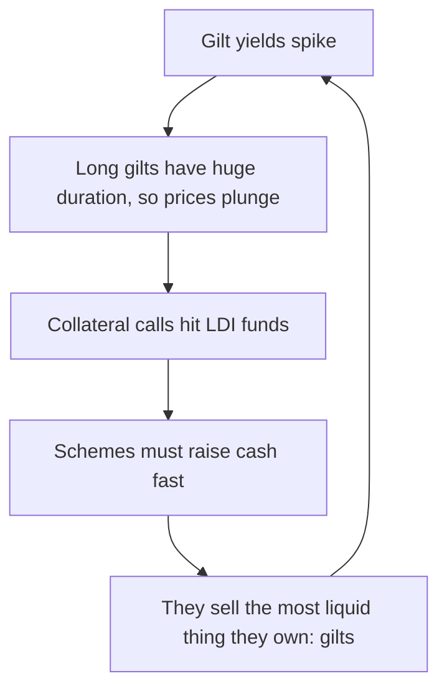

# Lesson 9: The Whole Market in Pictures

*Eighteen figures, one per idea, each captioned with what to notice and linked back to the lesson that taught it.*

---

## How to use this

Nothing here is new. It is the same arc you have just read, drawn rather than argued, which makes it useful twice over: as revision once you have finished the lessons, and as something to flick through before you next open the markets page.

The order follows the guide. Read a caption, look at the figure, and if the idea does not land, follow the link back to the lesson that builds it properly.

---

## Part 1: The scale of it

### 1. The base layer of global finance

The framing for the whole subject. Bonds are not a niche within finance. They are the layer everything else is priced off.

### 2. The largest market on earth

Bonds outstanding worldwide ($160.7tn) slightly exceed the value of all listed shares ($157.8tn). The interest rates produced here become the base price of money for governments, companies and homebuyers alike.

---

## Part 2: The core mechanism

*Taught in [Lesson 1: Anatomy and the Seesaw](?slug=global-bond-markets&lesson=lesson-01-anatomy-and-the-seesaw)*

### 3. The anatomy of a bond

Four terms are fixed at issue (issuer, face value, coupon and maturity) and two are set by the market (price and yield). The last two are where beginners stumble, because the coupon is a promise while the yield is what the market thinks that promise is worth.

### 4. The core mechanic: the seesaw

The single most important idea in the subject. The £5 coupon never changes, so the **price** must move until the overall return matches what the market currently demands. "Yields rose" and "bond prices fell" are the same headline written two ways.

### 5. Duration controls the volatility

The same one-point rise in yields costs the 2-year under 2%, the 10-year about 7%, and the 30-year about 14%. The owner of a long bond is stuck with a below-market coupon for many more years, and the price falls today to compensate a buyer for all of them. The durations shown are modified durations: each bond's balance point, the average wait for its discounted payments, divided by one plus the yield.

### 6. Duration risk materialised: Silicon Valley Bank

Lesson 1 said price swings wash out if you hold to maturity. SVB is the exception that defines the rule: a bank that must value holdings at market prices, and whose depositors can leave at any time, does not get to hold to maturity. *Also relevant to [Lesson 6](?slug=global-bond-markets&lesson=lesson-06-eight-headlines-eight-lessons).*

### 7. Convexity is an asymmetrical advantage

Gains exceed losses for equal moves in yield. The relationship between price and yield is a curve, not a line, and it always bends in the holder's favour. This is convexity, and it is why duration is only a local approximation.

---

## Part 3: What sets the level

*Taught in [Lesson 2: What Sets the Level of Yields](?slug=global-bond-markets&lesson=lesson-02-what-sets-the-level-of-yields)*

### 8. The architecture of a yield

<svg viewBox="0 0 700 300" width="100%" role="img" aria-label="Stacked diagram of yield components: expected policy rate at the base, term premium above it, and credit spread added only for non-government borrowers, with inflation cutting across to leave the real return" fill="none" xmlns="http://www.w3.org/2000/svg">
  <text x="140" y="24" font-size="13" fill="currentColor" text-anchor="middle" font-weight="bold" opacity="0.85">Government bond</text>
  <text x="420" y="24" font-size="13" fill="currentColor" text-anchor="middle" font-weight="bold" opacity="0.85">Corporate bond</text>
  <rect x="60" y="170" width="160" height="90" fill="#0f172a" opacity="0.82"/>
  <rect x="60" y="95" width="160" height="75" fill="#64748b" opacity="0.72"/>
  <rect x="340" y="170" width="160" height="90" fill="#0f172a" opacity="0.82"/>
  <rect x="340" y="95" width="160" height="75" fill="#64748b" opacity="0.72"/>
  <rect x="340" y="45" width="160" height="50" fill="#f43f5e" opacity="0.72"/>
  <g font-size="11" fill="#ffffff" text-anchor="middle" font-weight="600">
    <text x="140" y="198">Expected</text><text x="140" y="212">policy rate</text>
    <text x="140" y="138">Term premium</text>
    <text x="420" y="198">Expected</text><text x="420" y="212">policy rate</text>
    <text x="420" y="138">Term premium</text>
    <text x="420" y="75">Credit spread</text>
  </g>
  <line x1="60" y1="234" x2="500" y2="234" stroke="#fb923c" stroke-width="2.5" stroke-dasharray="7 4"/>
  <text x="556" y="231" font-size="11" fill="#fb923c" font-weight="bold">Inflation</text>
  <text x="556" y="245" font-size="10" fill="currentColor" opacity="0.65">everything below</text>
  <text x="556" y="257" font-size="10" fill="currentColor" opacity="0.65">is eaten by it</text>
  <line x1="42" y1="95" x2="42" y2="260" stroke="currentColor" stroke-width="1.5" opacity="0.5"/>
  <line x1="36" y1="95" x2="48" y2="95" stroke="currentColor" stroke-width="1.5" opacity="0.5"/>
  <line x1="36" y1="260" x2="48" y2="260" stroke="currentColor" stroke-width="1.5" opacity="0.5"/>
  <text x="22" y="182" font-size="11" fill="currentColor" text-anchor="middle" opacity="0.75" transform="rotate(-90 22 182)">Total yield</text>
  <line x1="518" y1="45" x2="518" y2="234" stroke="#10b981" stroke-width="1.5" opacity="0.8"/>
  <line x1="512" y1="45" x2="524" y2="45" stroke="#10b981" stroke-width="1.5"/>
  <line x1="512" y1="234" x2="524" y2="234" stroke="#10b981" stroke-width="1.5"/>
  <text x="536" y="130" font-size="11" fill="#10b981" font-weight="bold">Real</text>
  <text x="536" y="144" font-size="11" fill="#10b981" font-weight="bold">return</text>
  <text x="60" y="288" font-size="10" fill="currentColor" opacity="0.6">Block heights are illustrative. Every non-government borrower pays the government yield plus a spread.</text>
</svg>

Every yield decomposes. The expected policy rate at the base, the term premium above it, and for anyone other than the government a credit spread on top. Inflation cuts across all of it, leaving the real return. Lesson 3 puts a price on the top layer: in India in mid-2026, stepping down from AAA to single-A added roughly three to five percentage points.

### 9. The yield curve: finance's most watched gauge

Normally upward sloping, because commitment earns a premium. When inverted, the market expects rate cuts, which usually means it expects trouble. In the US an inversion has preceded every recession for half a century, but the curve stayed inverted for two years from mid-2022 without one arriving. A warning light, not a law of physics.

---

## Part 4: Bonds versus funds

*Taught in [Lesson 7: Risks, and Bonds versus Bond Funds](?slug=global-bond-markets&lesson=lesson-07-risks-and-bond-funds)*

### 10. Individual bonds versus bond funds

A bond matures; a fund never does. The bond's duration falls to zero as maturity approaches, so its price must converge on par. The fund's duration stays roughly constant, and its recovery comes instead from reinvesting at higher yields, which takes about as many years as its duration.

---

## Part 5: The market itself

*Taught in [Lesson 3: Instruments, Players, and Plumbing](?slug=global-bond-markets&lesson=lesson-03-instruments-players-and-plumbing)*

### 11. Market plumbing and the ecosystem

Bonds are born at auction in the primary market, trade over the counter in the secondary market, settle through clearing houses, and are financed overnight in the repo market. The central bank sits above all of it, and intervenes in repo first when something breaks.

---

## Part 6: Three markets

*Taught in [Lesson 5: Three Markets Up Close](?slug=global-bond-markets&lesson=lesson-05-three-markets-up-close)*

### 12. Global sovereign typology matrix

| | United States | United Kingdom | India |
| --- | --- | --- | --- |
| **Scale** | $61.2 trillion, 38% of the world's bonds | One of the oldest government bond markets, with roots in the 1690s | Large, mostly domestic, and joining emerging-market bond indices |
| **Name** | Treasuries | Gilts | G-secs and state SDLs |
| **Issued by** | US Treasury | Debt Management Office | RBI, for the government |
| **Anchor buyers** | Foreign investors, funds, the Fed | Pension funds, insurers, overseas | Banks, insurers, provident funds |
| **Inflation-linked** | TIPS | Index-linked gilts (an unusually large share) | Rarely issued |

The same physics, three characters. The US is the global benchmark at $61.2tn and 38% of world bonds; the UK is shaped by pension funds needing long, inflation-linked assets; India is domestic, partly captive by regulation, with the RBI playing three roles at once.

---

## Part 7: Why it matters

*Taught in [Lesson 4: The Gravitational Pull](?slug=global-bond-markets&lesson=lesson-04-the-gravitational-pull)*

### 13. The gravitational pull of the risk-free rate

The government yield is the floor under every other rate, so moving it moves everything above it: mortgages, company loans, share and property valuations, budget arithmetic and currencies. Note the India exception: most Indian home loans track the RBI's repo rate directly rather than the bond market.

---

## Part 8: When it breaks

*Taught in [Lesson 6: Eight Headlines, Eight Lessons](?slug=global-bond-markets&lesson=lesson-06-eight-headlines-eight-lessons)*

### 14. Macro gravity materialised: the UK, September 2022

The doom loop at the heart of the crisis: long gilts plunged on their enormous duration, collateral calls hit leveraged pension funds, and their forced selling pushed yields higher still. Unfunded tax cuts started it; the Bank of England ended it by buying the very bonds it had planned to sell.

### 15. Enter the bond vigilantes: the US, April 2025

<svg viewBox="0 0 700 340" width="100%" role="img" aria-label="US 10-year Treasury yield, daily closes from 2 to 11 April 2025: it fell from 4.20 percent to 4.01 percent on 4 April as investors fled to safety, then rose every day to 4.48 percent on 11 April, a rise of 47 basis points in a week" fill="none" xmlns="http://www.w3.org/2000/svg">
  <g stroke="currentColor" opacity="0.14" stroke-width="1">
    <line x1="80" y1="50" x2="660" y2="50"/><line x1="80" y1="100" x2="660" y2="100"/>
    <line x1="80" y1="150" x2="660" y2="150"/><line x1="80" y1="200" x2="660" y2="200"/>
  </g>
  <line x1="80" y1="250" x2="660" y2="250" stroke="currentColor" stroke-width="1.5" opacity="0.6"/>
  <line x1="80" y1="40" x2="80" y2="250" stroke="currentColor" stroke-width="1.5" opacity="0.6"/>
  <polyline points="80,150 160,185 240,197.5 320,162.5 400,135 480,115 560,100 640,80" stroke="#f43f5e" stroke-width="2.5" fill="none"/>
  <g fill="#f43f5e"><circle cx="80" cy="150" r="3.5"/><circle cx="160" cy="185" r="3.5"/><circle cx="320" cy="162.5" r="3.5"/><circle cx="400" cy="135" r="3.5"/><circle cx="480" cy="115" r="3.5"/><circle cx="560" cy="100" r="3.5"/></g>
  <circle cx="240" cy="197.5" r="5.5" fill="#10b981"/>
  <circle cx="640" cy="80" r="5.5" fill="#f43f5e"/>
  <line x1="480" y1="60" x2="480" y2="250" stroke="currentColor" stroke-width="1" opacity="0.45" stroke-dasharray="4 4"/>
  <text x="486" y="72" font-size="11" fill="currentColor" opacity="0.8">9 Apr: 90-day pause</text>
  <text x="240" y="222" font-size="11" fill="#10b981" text-anchor="middle" font-weight="bold">4.01%</text>
  <text x="240" y="236" font-size="10" fill="currentColor" text-anchor="middle" opacity="0.7">flight to safety</text>
  <text x="640" y="68" font-size="11" fill="#f43f5e" text-anchor="end" font-weight="bold">4.48%</text>
  <g font-size="11" fill="currentColor" opacity="0.7" text-anchor="end" font-family="ui-monospace,monospace">
    <text x="70" y="54">4.6</text><text x="70" y="104">4.4</text><text x="70" y="154">4.2</text>
    <text x="70" y="204">4.0</text><text x="70" y="254">3.8</text>
  </g>
  <g font-size="10" fill="currentColor" opacity="0.6" text-anchor="middle">
    <text x="80" y="268">2 Apr</text><text x="240" y="268">4 Apr</text><text x="400" y="268">8 Apr</text><text x="640" y="268">11 Apr</text>
  </g>
  <text x="26" y="145" font-size="11" fill="currentColor" text-anchor="middle" opacity="0.75" transform="rotate(-90 26 145)">Yield (%)</text>
  <text x="370" y="296" font-size="12" fill="currentColor" text-anchor="middle" font-weight="bold">US 10-year Treasury yield, April 2025</text>
  <text x="370" y="314" font-size="11" fill="currentColor" text-anchor="middle" opacity="0.75">+47 bp over the week: the largest weekly rise since November 2001</text>
  <text x="370" y="330" font-size="10" fill="currentColor" text-anchor="middle" opacity="0.55">Daily closes, US Treasury constant-maturity data. The 30-year rose 44 bp, its biggest weekly rise since 1987.</text>
</svg>

**Bond vigilantes:** investors who sell a government's debt to punish policies they judge reckless. Tariffs announced on 2 April first produced a textbook flight to safety, taking the 10-year down to about 4.0%. Then the textbook broke: Treasuries fell alongside shares *and* the dollar, the signature of lost confidence rather than repricing. The President paused the steepest tariffs on 9 April and later said he had been watching the bond market.

---

## Part 9: What can go wrong

*Taught in [Lesson 7: Risks, and Bonds versus Bond Funds](?slug=global-bond-markets&lesson=lesson-07-risks-and-bond-funds)*

### 16. The five embedded risks

The seesaw, the spread, the eraser, the exit and the exchange. They are genuinely distinct: a bond can be certain to pay in full and still lose you a great deal of money, and each has a different remedy.

---

## Part 10: Putting it together

### 17. System synthesis: September 2026

<svg viewBox="0 0 700 265" width="100%" role="img" aria-label="Horizontal bars comparing ten-year government bond yields in September 2026: the United States 5.29 percent, the United Kingdom 5.35 percent and India 7.11 percent, a gap of about 1.8 percentage points between the US and India." fill="none" xmlns="http://www.w3.org/2000/svg">
  <g stroke="currentColor" opacity="0.12" stroke-width="1"><line x1="245.0" y1="30" x2="245.0" y2="190"/><line x1="340.0" y1="30" x2="340.0" y2="190"/><line x1="435.0" y1="30" x2="435.0" y2="190"/><line x1="530.0" y1="30" x2="530.0" y2="190"/><line x1="625.0" y1="30" x2="625.0" y2="190"/></g>
  <line x1="150" y1="190" x2="660" y2="190" stroke="currentColor" stroke-width="1.5" opacity="0.6"/>
  <rect x="150" y="48" width="217.6" height="30" fill="#0ea5e9" opacity="0.85" rx="3"/><rect x="150" y="98" width="223.2" height="30" fill="#6366f1" opacity="0.85" rx="3"/><rect x="150" y="148" width="390.5" height="30" fill="#f59e0b" opacity="0.85" rx="3"/>
  <g font-size="12" fill="currentColor" text-anchor="end" font-weight="600"><text x="140" y="68">United States</text><text x="140" y="118">United Kingdom</text><text x="140" y="168">India</text></g>
  <g font-size="12" fill="currentColor" font-weight="bold" font-family="ui-monospace,monospace"><text x="377.6" y="68">5.29%</text><text x="383.2" y="118">5.35%</text><text x="550.5" y="168">7.11%</text></g>
  <line x1="367.6" y1="44" x2="367.6" y2="214" stroke="#f59e0b" stroke-width="1" opacity="0.45" stroke-dasharray="4 4"/>
  <line x1="540.5" y1="144" x2="540.5" y2="214" stroke="#f59e0b" stroke-width="1" opacity="0.45" stroke-dasharray="4 4"/>
  <line x1="367.6" y1="222" x2="540.5" y2="222" stroke="#f59e0b" stroke-width="1.5"/>
  <text x="454.0" y="238" font-size="11" fill="#f59e0b" text-anchor="middle" font-weight="bold">about 1.8 points</text>
  <g font-size="10" fill="currentColor" opacity="0.6" text-anchor="middle"><text x="150.0" y="205">3%</text><text x="245.0" y="205">4%</text><text x="340.0" y="205">5%</text><text x="435.0" y="205">6%</text><text x="530.0" y="205">7%</text><text x="625.0" y="205">8%</text></g>
  <text x="405" y="258" font-size="11" fill="currentColor" text-anchor="middle" opacity="0.75">10-year government bond yields, September 2026. The gap is not free money; the next section takes it apart.</text>
</svg>

Every concept in the guide, running at once. An energy shock became inflation, became policy tightening, became higher yields, and crossed three borders within days. Note India's driver: a US Treasury sell-off and crude prices, not a domestic policy change. *[Lesson 5](?slug=global-bond-markets&lesson=lesson-05-three-markets-up-close).*

### 18. Decoding the headlines: a translation matrix

| The headline says | It means |
| --- | --- |
| **"Yields jumped 15 basis points"** | Bond prices fell, and borrowing just got more expensive across the economy |
| **"The curve steepened"** | Long-term yields rose relative to short-term ones, often on inflation or government-debt worries |
| **"The curve inverted"** | Short-term yields are above long-term ones, because markets expect rate cuts in a slowdown |
| **"Spreads widened"** | Investors want more to lend to companies, a sign of rising default fears |
| **"Flight to safety"** | Frightened investors are buying government bonds, pushing their yields down |
| **"The auction tailed"** | The government had to pay a higher yield than expected: soft demand for its debt |
| **"Bond vigilantes"** | Investors selling a government's debt to punish policies they see as reckless |

The practical payoff. Jargon on the left, meaning on the right. Central banks steer the short end; inflation, borrowing and confidence drive the long end; and the market is entirely global. *[Lesson 8](?slug=global-bond-markets&lesson=lesson-08-reading-the-market-yourself).*

---

## That is the whole guide

You started with a loan turned into a piece of paper. You now know why its price moves against its yield, how far, and what sets the level; who trades it and on what plumbing; why it prices your mortgage and the stock market; how it behaves in three different countries; what it looks like when it breaks; and how to read what it is saying.

The last thing worth saying is the one from Lesson 8. When you read someone's confident narrative about where yields are going, ask what would prove it wrong, and who benefits if you believe it. Then go and check the primary data yourself. It is free, and almost nobody does.
